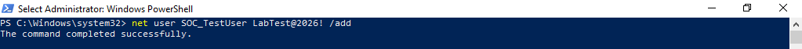
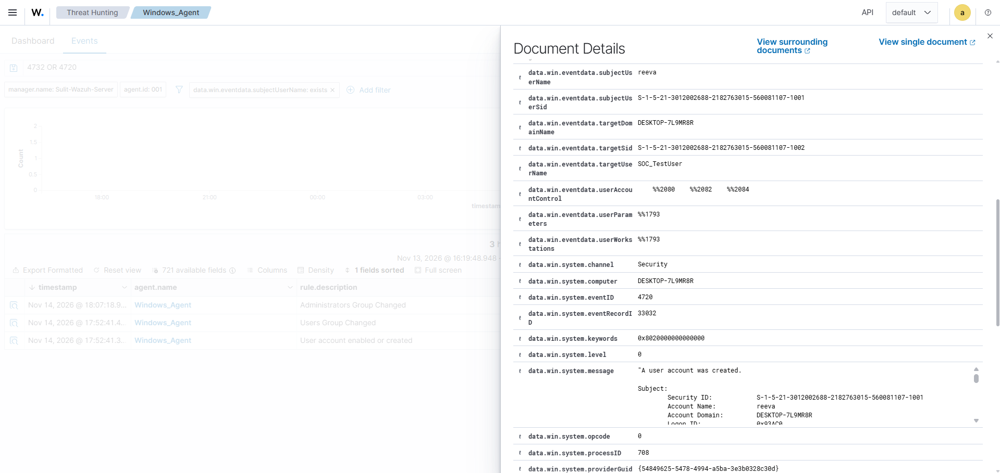
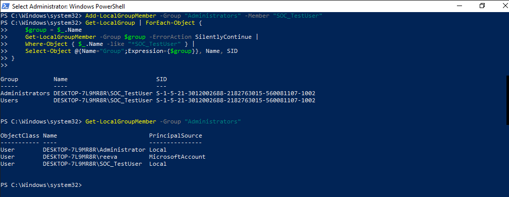
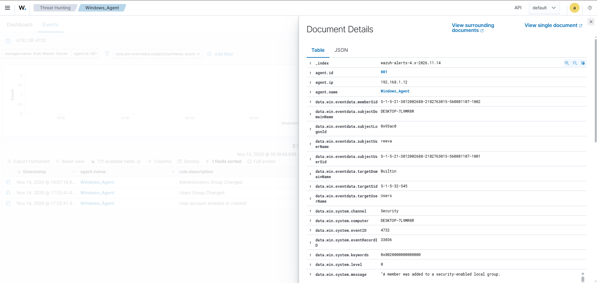
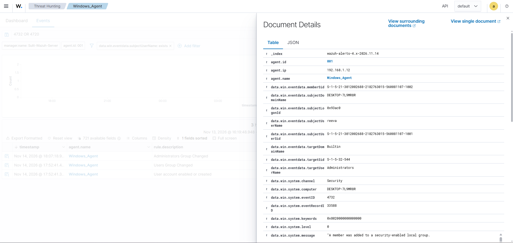

Full Incident Investigation

## 1. Objective

The objective of this activity is to simulate and investigate suspicious account management activities on a Windows machine using Wazuh SIEM. The activity focuses on detecting a newly created user account and checking whether it was given administrator privileges.

## 2. Lab Environment

| Component | Details |
|---|---|
| Operating System | Windows |
| Hostname | DESKTOP-7L9MR8R |
| IP Address | 192.168.1.12 |
| SIEM | Wazuh |
| Agent Name | Windows_Agent |
| Account Used | reeva |
| Test Account | SOC_TestUser |

## 3. Activity Performed

### 3.1 Creating a New Local User Account

I created a new local account named `SOC_TestUser` using PowerShell with Administrator privileges.

Command used:

```powershell
net user SOC_TestUser LabTest@2026! /add
```

The command completed successfully and created the account.



### 3.2 Checking the Account Creation Event in Wazuh

After creating the account, I opened Wazuh Dashboard and searched for Windows Event ID `4720`.

Wazuh detected the activity with the following details:

- Event ID: 4720
- Wazuh Rule ID: 60109
- Description: User account enabled or created
- Account Created: SOC_TestUser
- Subject Username: reeva
- Computer: DESKTOP-7L9MR8R

This event confirmed that the new account was successfully created and identified the user responsible for the action.



### 3.3 Adding the Account to the Administrators Group

Next, I attempted to add `SOC_TestUser` to the local Administrators group.

The first command using `net localgroup` returned an error stating that the specified local group did not exist.

I then used the PowerShell command:

```powershell
Add-LocalGroupMember -Group "Administrators" -Member "SOC_TestUser"
```

The command did not display a success message, but it returned to the PowerShell prompt without an error.

I verified the account's group memberships and confirmed that `SOC_TestUser` was a member of both the Users and Administrators groups.



### 3.4 Investigating the Group Membership Change

I returned to Wazuh and searched for Windows Event ID `4732`.

The first event showed that a member was added to the local Users group.

I then found another Event ID `4732` showing that a member was added to the local Administrators group.

The event details included:

- Event ID: 4732
- Wazuh Rule ID: 60170
- Description: Administrators Group Changed
- Subject Username: reeva
- Target Group: Administrators
- Target Domain: Builtin
- Member SID: S-1-5-21-3012002688-2182763015-560081107-1002

The member SID matched the SID of `SOC_TestUser`.

This confirmed that the account was successfully added to the Administrators group.





## 4. Detection and Evidence

The following Windows security events were detected through Wazuh:

| Event ID | Description | Wazuh Rule ID |
|---|---|---|
| 4720 | User account created | 60109 |
| 4732 | Member added to Users group | 60170 |
| 4732 | Member added to Administrators group | 60170 |

Wazuh successfully collected the account creation and group membership events from the Windows agent.

I also searched for Event ID `4104` to check PowerShell Script Block Logging events. However, no matching result was found during the investigation.

## 5. Investigation and Analysis

During the investigation, I found that a new local account named `SOC_TestUser` was created on the Windows machine.

The event details identified `reeva` as the subject username responsible for the account creation and group membership changes.

The account was initially added to the Users group and was later added to the Administrators group.

Adding administrator privileges to a newly created account can be suspicious because it gives the account elevated permissions to perform administrative actions on the machine.

However, these events alone do not prove that an attacker performed the actions. Additional verification is needed to determine whether the activities were authorized.

## 6. Findings and Conclusion

Based on the investigation, the following activities were identified:

1. A new local account named `SOC_TestUser` was created.
2. The account was added to the local Users group.
3. The account was added to the local Administrators group.
4. The actions were associated with the account `reeva`.
5. Wazuh successfully detected the account creation and group membership changes.

The activity was classified as **suspicious activity requiring further investigation**.

Since the actions were intentionally performed during this lab, this was a controlled simulation and not an actual security incident.

## 7. Recommended Response

If this activity occurred in an actual company environment, I would:

1. Review the account creation and group membership events.
2. Verify with the account owner or system administrator whether the changes were authorized.
3. Check for other suspicious activities associated with the account.
4. Escalate the findings to the appropriate security or incident response team if the activity is unauthorized or remains suspicious.
5. Follow the organization's incident response playbook before disabling the account or taking containment actions.

## 8. Lessons Learned

Through this activity, I learned how to investigate Windows account creation and group membership changes using Wazuh.

I also learned that creating a new account and assigning it administrator privileges can be an indicator of suspicious activity. However, alerts should not automatically be considered attacks without proper investigation and verification.

This activity helped me understand how a SOC analyst can use Windows security events to identify who performed an action, what account was affected, and what changes were made to the system.
